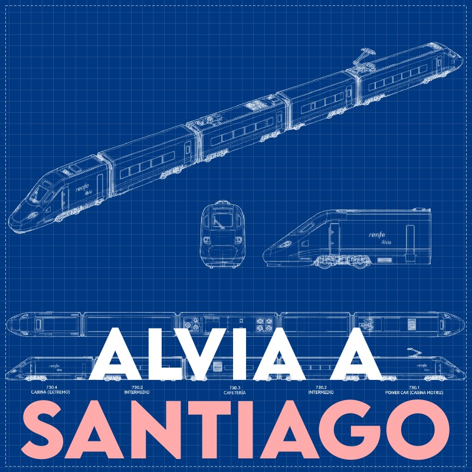

Éste es el tercer episodio del podcast "Cuando todo sale mal".
Escúchalo en [Spotify](https://open.spotify.com/episode/20fUOsj24csh1s7poj3m6z?si=fKS2rR7XRvy6ZY7SKVZYCw).
<!--
[Amazon Music](https://music.amazon.com/podcasts/06feef17-8687-4861-9d32-ed762264df9f/episodes/be9742f7-e269-4ebc-ae71-8b7c94915423/cuando-todo-sale-mal-explosi%C3%B3n-del-challenger),
[Apple Podcasts](https://podcasts.apple.com/us/podcast/explosi%C3%B3n-del-challenger/id1896853464?i=1000783491347),
[Castbox](https://castbox.fm/episode/Explosi%C3%B3n-del-Challenger-id7250793-id983838396),
[Pocket Casts](https://pca.st/t4maghtw),
[YouTube](https://youtu.be/efxkoEMsHBU),
o baja el [mp3](https://pinchito.es/audio/cuando-todo-03-santiago.mp3).
-->

Este artículo es su compañero fiel:
puedes encontrar aquí la transcripción completa,
junto con fuentes, notas y música.

# Episodio 03: Alvia a Santiago

En esta ocasión vamos a quedarnos en España.
Estamos en Santiago de Compostela, el 24 de julio de 2013.
El tren Alvia de las 20:41 está llegando a la estación,
el segundo que hace la ruta Madrid-Santiago hoy.

Al llegar a la curva de Angrois el Alvia debería haber frenado a 80 km/h,
pero algo va muy mal:
sigue a 200 km/h.
El maquinista activa los frenos de emergencia, pero ya es tarde:
en el tramo que queda sólo consigue reducir a 190 km/h.
El tren descarrila sin remedio:
los vagones van saliéndose de la vía y estampándose contra la pared de hormigón.

Al llegar a socorrer a los pasajeros,
los bomberos se encuentran con un espectáculo dantesco:
vagones en llamas y decenas de víctimas mortales.
¿Qué ha salido mal?

Estamos en "Cuando todo sale mal",
con tu anfitrión Alex Fernández, "pinchito".
En este episodio vamos a analizar las causas del accidente del Alvia a Santiago,
el peor de la alta velocidad española.
Repasaremos la investigación y el juicio,
y veremos las medidas que se han tomado (y las que no) a raíz de esta tragedia.

## Capítulo 1: el accidente

Antes de nada, un aviso:
adelanto que vamos a repasar situaciones muy duras desde el punto de vista humano,
difíciles de revisar en frío.

Un accidente de este tipo siempre tiene varias capas,
como una cebolla que hay que ir pelando.
También como una cebolla,
te pueden hacer llorar.
Nuestro objetivo es un análisis técnico,
así que intentaremos no dejarnos llevar por el terrible drama humano.

### El accidente

Portada de El País el 25 de julio de 2013, el día después del accidente:
Tragedia en el tren de Santiago.
Al menos 60 muertos y más de un centenar de heridos al salirse de la vía
en una curva pronunciada un Alvia con 218 pasajeros.
El convoy circulaba con exceso de velocidad.
La grabación entre el maquinista y control: "¡Voy a 190!"

Vamos a acompañar al maquinista Paco Garzón en este fatídico viaje.
Es un profesional hijo de ferroviario con 30 años de experiencia trabajando en Renfe,
y más de diez como maquinista.

El tren Alvia sale de Madrid Chamartín a las 15:00 del 24 de julio de 2013.
Parece un viaje tranquilo,
como los otros 59 que lleva ya Garzón en el cuerpo,
en el mismo trayecto de alta velocidad Madrid-Santiago,
en un tren parecido.

Al pasar León el tren emboca la recta final:
los últimos 78 km de recta casi ininterrumpida,
con 31 túneles y 35 puentes,
en los que el tren alcanza fácilmente los 200 km/h.

Ya llegando al final de esta recta hay tres túneles casi idénticos.
El maquinista tiene que recordar por qué túnel va,
y que tras el tercero tiene que reducir la velocidad de 200 a 80 km/h.
La llegada a la estación de Santiago es complicada:
la vía da un giro brusco de 400 m de radio en la tremenda curva de Angrois,
donde la velocidad está limitada a 80 km/h.

En el segundo túnel de los tres, a las 20:39 horas,
Paco Garzón recibe una llamada del interventor.
Es su obligación responder: el tren puede estar incendiándose.

Esto le provoca una "pérdida de conciencia situacional",
como declarará después.
Vamos, un despiste.
Cuando ve la señal de 80 km/h es ya tarde:
el tren circula todavía a más de 200 km/h, y le queda menos de un minuto para llegar a la curva.
Empieza a frenar a la desesperada, pero no hay tiempo.

Todos los vagones descarrilan,
matando instantáneamente al menos a 60 personas.
En total va a haber 80 víctimas mortales y 152 personas heridas.

Portadas de El País los días tras el accidente:

- 25 de julio: Caímos al suelo y nos vimos rodeados de muertos.
- 27 de julio: "Ni sé si saldré. Me ahogo. Aplastada."
El whatsapp de una superviviente ilustra el infierno del accidente.

En contra de lo que podríamos esperar,
se sufren más daños en la parte trasera del tren.
para ser exactos los vagones en las posiciones 5, 6, 9, 12 y 13.
Se estrellan contra un muro de hormigón a la derecha de la vía,
y quedan encajonados en una cuneta.
El vagón número 8 salta por encima del terraplén,
y el número 9 queda completamente partido por la mitad.

Es el accidente más grave de la alta velocidad española,
y posiblemente el peor de la historia de España en cualquier tipo de tren.
Aquí como en otras áreas,
el registro histórico está un poco enturbiado por la censura franquista:
aunque el accidente de 1944 en Torre del Bierzo mató oficialmente a 78 personas,
se sospecha bastante fuerte que el régimen pudo ocultar la cifra real de más de 100 muertos.

¿Y en el resto del mundo?
Ha habido accidentes de tren terribles con varios cientos de muertos.
Pero si nos centramos en alta velocidad,
globalmente este accidente sólo ha sido superado
por el de 1998 en Schede, Alemania, con 101 víctimas.
Gracias a esta estadística macabra podemos ver la magnitud del accidente.

### Repercusión mediática

La catástrofe tuvo repercusión internacional.
Apareció en las portadas de Le Monde,
Süddeutsche Zeitung,
el New York Times,
el Washington Post,
The Guardian (el día 26),
The Japan Times (el 28),
básicamente todos los periódicos importantes que me he molestado en consultar.

Portada de El País el 26 de julio de 2013, dos días tras el accidente:

- El tren frenó demasiado tarde.
Al menos 80 fallecidos y 32 heridos muy graves en la tragedia de Santiago.
Nuevos detalles de la grabación del maquinista revelan el exceso de velocidad:
"Tenía que ir a 80 y voy a 190".
El conductor intentó parar el convoy al activarse la alarma.

### El maquinista

Al poco de ocurrir el accidente,
los medios de comunicación empiezan a buscar las causas,
como suele pasar.
Casualmente se filtran a la prensa grabaciones de la caja negra del tren,
en las que el conductor dice que va demasiado rápido.
Todo apunta a un error humano.

No sabemos si por suerte o por desgracia para él,
el maquinista sobrevive.
Tendrá que llevar en su conciencia toda la vida el haber causado esta catástrofe.
Lo ingresan en el hospital con heridas y tres costillas rotas.
A los tres días el ministro del interior comparece ante los medios de comunicación:
el conductor está en la cárcel, costillas rotas y todo.

> el maquinista está en situación jurídica de detenido por la policía
> con la imputación del presunto delito de homicidio por imprudencia.

Más portadas de El País:

- 29 de julio: El maquinista del tren asume el "despiste" que provocó la tragedia.
El juez deja libre con cargos a Francisco Garzón,
le imputa 79 delitos de homicidio y le retira durante seis meses el pasaporte y la licencia.
- 30 de julio: "¿Cómo quiere que me calme?
Con lo que he provocado, prefiero morir."
El maquinista se sinceró ante la policía y admitió su error.

A continuación Garzón se encierra en su casa bajo tratamiento psicológico.

Y todavía más portadas de El País:

- 31 de julio: El maquinista hablaba por el teléfono móvil antes de descarrilar.
Garzón empezó a frenar a 250 metros de la curva y a 184 por hora.
- 1 de agosto: Así fue la tragedia del tren de Santiago.
El revisor telefoneó desde el convoy al maquinista para pedirle que apeara a una familia en Pontedeume.
Tras dos minutos de charla, a las 20:41, el Alvia descarriló.

Más adelante va a declarar ante la mesa del congreso:

> Solicitar el perdón, y que...
> prefería haber muerto yo, a uno de ellos,
> si con eso se evitaba una mínima muerte.

La cosa parece que está bastante clara: un error humano.
Pero en este podcast hacemos análisis de incidentes;
así que siempre conviene seguir rascando un poco para entender bien una catástrofe.

### Trenes Alvia

Nuestra primera tarea es investigar qué son y cómo funcionan los trenes Alvia.
Son un pequeño triunfo de la ingeniería para resolver un problema muy concreto:
la transición en caliente entre vías existentes de distinto ancho.

Los primeros trenes AVE consistían en una locomotora alemana con vagones franceses,
así que las primeras líneas de alta velocidad tuvieron que hacerse desde cero con el ancho europeo.
Seguro que estás imaginándote unas vías ibéricas estrechitas
dando paso a unas robustas vías europeas anchas y resplandecientes.
Lo mismo me pasaba a mí hasta que lo comprobé,
pero resulta que no:
el ancho ibérico es en realidad un 16% mayor que el estándar europeo.
Tiene sentido porque los ferrocarriles en la península ibérica siempre han tenido que ir por caminos bastante montañosos,
y necesitaban más estabilidad.

Las series 130 y 730 de Renfe están diseñadas y fabricadas en España,
y pueden cambiar sin parar de una vía a la otra.
Llegan a los 250 km/h en los tramos nuevos de ancho europeo.
y unos respetables 220 km/h en tramos de ancho ibérico.
Este compromiso resulta muy atractivo para el gobierno,
que puede reutilizar tramos existentes en vez de hacer toda la vía nueva.
Esto tiene su importancia para la historia,
como vamos a ver más adelante.

### Contexto político

Vamos a recordar el contexto político del momento:
el presidente del gobierno era por aquel entonces Mariano Rajoy,
del Partido Popular.
El 1 de agosto de 2013, justo la semana después del accidente del Alvia,
Rajoy se defendía así en el congreso de acusaciones de corrupción:

> "Fin de la cita".

Como nos gusta escuchar a Don Mariano,
vamos a ir reviviendo sus mejores frases para aliviar un poco el peso de la tragedia que estamos tratando.

## Capítulo 2: la investigación

El accidente es bastante reciente,
así que tenemos acceso a un montón de documentación contemporánea,
lo que se suele llamar en historia "fuentes primarias".

Portada de El País el 27 de julio de 2013:
Los presidentes de Renfe y Adif culpan al maquinista del tren de Santiago.
Los responsables ferroviarios dicen que debería haber reducido antes la velocidad.
El conductor se niega a declarar ante la policía.

Para empezar vamos a ver la investigación oficial.
El Ministerio de Transportes avisó el mismo 24 de julio a la Comisión de Investigación de Accidentes Ferroviarios,
la CIAF, responsable de elaborar el informe oficial del accidente.

Este ladrillo de 266 páginas se publicó en junio de 2014,
menos de un año después.
En la portada se declara ufanamente:

> La investigación técnica de los accidentes ferroviarios tendrá como finalidad
> determinar las causas de los mismos y las circunstancias en que se produjeron,
> con objeto de prevenirlos en el futuro, y formular las recomendaciones
> oportunas para reducir los riesgos en el transporte ferroviario. Dicha
> investigación no se ocupará, en ningún caso, de la determinación de la culpa o
> responsabilidad y será independiente de cualquier investigación judicial.
> (R.D. 810/2007, de 22 de junio, en su Título III; artículo 21).

Suena muy razonable; veremos si se cumple.
Ahora leemos el informe desde el principio:

> Conclusión: La causa del accidente fue un exceso de velocidad del tren (circulaba a 179 km/h) en la
> curva de entrada a Bifurcación A Grandeira (curva de Angrois, limitada a 80 km/h)
> [...]

> Como causa coadyuvante se apunta una falta de atención del personal de conducción al responder
> éste una llamada telefónica de servicio del propio tren, proveniente del interventor, lo que motivó la no
> aplicación del freno de forma adecuada para reducir la velocidad antes de la entrada a dicha curva.

Bueno, pues parece que la cosa está clarísima:
el maquinista lo hizo horriblemente mal y tuvo toda la culpa.
Tenía que frenar y no frenó.
Para no ocuparse de determinar la culpa o responsabilidad,
como habían prometido al principio del informe,
lo están poniendo a huevo.
Vamos a ver las recomendaciones que vienen justo después:

> Normativizar que todas las reducciones de velocidad a
> partir de un cierto rango estén señalizadas en la vía con
> señales fijas de limitación de velocidad.

Es decir, mejorar la señalización en toda la red de trenes.
Pero un momento, esto es raro:
si está tan claro que fue error humano, ¿por qué hace falta mejorar la señalización?
¿No estaba ya bien señalizado?
Seguimos.

> Para estas situaciones (reducciones significativas de
> velocidad), gestionar la implantación progresiva de
> balizas que puedan ayudar a controlar la velocidad de los
> trenes, de modo que se produzca su frenado en el caso
> de que se pueda llegar a rebasar la velocidad máxima
> con la que debe ingresar en el tramo siguiente.

Esto tiene sentido:
que haya un control automático por si el maquinista no cumple los límites.
Pero, ¿no había ya de esto?
¿Cualquier despiste del conductor podía acabar en decenas de muertos?
La recomendación sigue:

> Para ello,
> impulsar los desarrollos tecnológicos necesarios del
> sistema ASFA Digital.

Estas siglas "ASFA" van a ser cruciales más adelante:
significan Anuncio de Señales y Frenado Automático,
un sistema diseñado por RENFE en los años 70.
En 2005 Adif encargó una modernización que llamó "ASFA Digital",
pasando básicamente de encender luces y pitidos a mostrar pantallas en los trenes.

Resumo el resto de recomendaciones:

- Detectar deficiencias de seguridad para la gestión preventiva,
en Renfe y el resto de empresas ferroviarias.
- Establecer comisiones de seguridad.
- Análisis de riesgos específicos en nuevas líneas,
en concreto relacionados con el personal de conducción.
- Realizar las comunicaciones en cabina de forma segura.
- Sistemas de grabación de audio y vídeo en las cabinas de conducción,
en Renfe y demás empresas.

Todas muy razonables,
pero ¿no parecen apuntar a que podría haber ciertas deficiencias en este tramo concreto?
A mí me suena como si tras un accidente de coche dijéramos:

> La causa es un despiste del conductor.
> Recomendaciones: señalizar las curvas cerradas sin visibilidad
> y evitar que haya socavones llenos de piedras afiladas en la carretera.

El maquinista tenía que estar pendiente del recorrido en todo momento para no despistarse,
en 200 km de trayecto casi recto con 35 túneles,
que terminaban en tres túneles seguidos a 200 km/h;
sin ningún tipo de aviso externo, ni auditivo ni visual.
Al mismo tiempo tenía que estar pendiente del tren,
por ejemplo para recibir las llamadas del interventor por si había alguna emergencia.
Juzga por ti mismo si era seguridad suficiente como para poner en sus manos las vidas de doscientas personas.
Yo desde luego no me sentiría tranquilo confiando mi triste envoltorio mortal a un sistema así.

En el resto del informe hay más cosas notables.
Por ejemplo, leemos que la comisión investigadora de la CIAF estaba integrada por:
un técnico del ministerio y los directores de seguridad de Renfe y de Adif,
la empresa que administra las infraestructuras ferroviarias.
Todos del Ministerio de Transporte.
Con ayuda de técnicos de INECO, una empresa pública que depende también del mismo ministerio.
No parece lo que llamaríamos una investigación independiente.

Al describir el tren de la serie 730 se dice (página 13):

> Está equipada con sistema ASFA Digital y con ERTMS/ETCS,
> aunque poco después de iniciarse la explotación comercial en la línea Ourense-Santiago,
> por problemas de fiabilidad y disponibilidad con la configuración del sistema ERTMS de esa serie 730 en esta línea,
> el operador (Renfe Operadora) solicitó circular al amparo del bloqueo de señalización
> lateral (BSL) y con la protección del ASFA Digital,
> siendo autorizado a ello por Adif.

De nuevo encontramos aquí el ASFA Digital,
y además un nuevo sistema de alarma ERTMS, por sus siglas en inglés:
_European Rail Traffic Management System_.
Su componente crucial es el ETCS:
_European Train Control System_,
que se usa de manera indistinta en el texto.
Además tenemos un cambio misterioso de uno a otro donde vamos a tener que bucear.

### Problemas de compatibilidad de software

Seguimos con el informe oficial.
En la página 85 leemos que en junio de 2012 se pusieron en servicio los trenes de la serie 730,
que dieron algunos problemas.
Tenemos una copia del mail del 23 de junio de 2012 donde el director de seguridad de Renfe explica el problema:
la versión 3.1.0.1 del ETCS del fabricante Bombardier no se lleva bien con la versión de la vía.
Se pide a este fabricante que arregle los problemas o se vuelva a la versión anterior,
y se pide la desconexión temporal del ERTMS.

La instalación de una versión que rompe cosas sonará familiar a cualquiera
que haya usado software en su ordenador alguna vez.
Dos días después el director de seguridad de Adif, Andrés Cortabitarte,
autoriza la desconexión del ERTMS en esa línea.

Escuchemos a este director de seguridad explicar el asunto en el juicio posterior:

> Tal es el desastre que [...] la Renfe pues pidió que se le desconectara.
> No hacía falta, pero nosotros así con todo se lo dimos.
> ¿Por qué razón? Porque la circulación ERTMS o la circulación con ASFA
> [...] están plenamente autorizadas.

Sólo se le olvida el pequeño detalle de que la autorización la había dado él mismo.
Además de que los trenes que habían hecho el viaje hasta el momento,
según el informe, no eran de alta velocidad.

En la página 86 se cuenta que Bombardier,
la empresa que hace el software,
entregó la nueva versión 3.1.1.2 en noviembre de 2012.
Renfe la probó con éxito, pero nunca se llegó a activar en los trenes.
¿Por qué, si ya estaba corregida?
El informe sólo explica de forma bastante críptica
que "aún persiste la posibilidad de la no lectura de balizas".

Esto me parece un punto crucial.

### Informe pericial

Llegamos ahora a la parte más densa de la investigación.
Vamos a repasar esta desconexión del ERTMS,
que no queda clara del todo en el informe oficial de la CIAF.

Para esto nos vamos a ayudar del informe pericial de "sólo" 96 páginas,
encargado por el tribunal y entregado el 27 de enero de 2017.
Tiene la ventaja de que lo realizó el ingeniero de caminos César Mariñas,
elegido por sorteo puro como perito judicial;
con lo cual su independencia está garantizada.
Leemos en la página 44:

> El sistema ASFA Digital ofrece una protección limitada y no debe interpretarse,
> por tanto, que es un sistema de supervisión total.

> [...] la autorización de ADIF para operar en ASFA en vez de ETCS n1
> fue circunstancial y de carácter provisional originada por un problema
> cuyos responsables estaban instados a resolver a la mayor brevedad.
> Por ello, y por la degradación de funcionalidades de seguridad que tal decisión reportaba,
> parece razonable que se hubiese tomado alguna medida de seguridad complementaria
> y de carácter provisional para tratar de compensar o mitigar
> la degradación del nivel de seguridad incurrido.
> [...]

Según este informe pericial había otros trenes con el mismo sistema ERTMS,
que parece que funcionaban bien.
También se explica que Adif (responsable de la vía)
pensó que el problema era responsabilidad de Renfe (responsable de los trenes) y viceversa.
Seguimos:

> La implementación de lo anterior no parece excesivamente complicada
> habida cuenta de las distintas posibilidades que se podían haber evaluado,
> como podría ser la colocación de balizas de limitación temporal ASFA [...].

Recordemos que el informe oficial recomienda implementar unas balizas para aumentar la seguridad,
que son unas estructuras que se montan en la vía y que se comunican con el tren en marcha;
si el tren va demasiado rápido inician un frenado de urgencia.
Resulta que con el sistema ASFA también puede limitarse la velocidad de forma automática.
El problema no es entonces que se desactivara el ERTMS;
sino que su reemplazo ni siquiera estaba bien instalado,
con lo que no cumplía sus funciones de seguridad.

### Sistemas de alarma

Vamos a poner todo esto en claro.
Tenemos un sistema de seguridad europeo ERTMS (o ETCS) que proporciona seguridad total.
También tenemos el ASFA Digital, más limitado, que en informática llamaríamos _legacy_,
y que funciona como respaldo.

Manuel Prieto, el abogado del maquinista,
declarará en el programa Salvados:

> Esta línea estaba prevista en un principio con el ERTMS instalado desde Orense hasta Santiago.
> El ERTMS es un sistema ferroviario de control permanente de velocidad.
> El maquinista no tiene que mirar a la vía.
> En una pantalla le aparece cómo están las señales.
> Y le está diciendo: reconócela, y frena.
> Y si no lo haces, yo te freno.
> [...]
> Ése era el proyecto original.
> ¿Qué ocurrió?
> Que le desconectaron el ERTMS al tren.
> ¿Qué habría evitado el accidente que se hizo?
> Además tenían que llevar una baliza ASFA, porque ya no estaba el ERTMS;
> una baliza de otro sistema, más primitivo pero también en este caso muy eficaz.
> Es, si no reduces a 160 aquí, y si no reduces a 80 aquí,
> freno el tren y lo paro.
> Tampoco estaba.
> Todo eso se puso después del accidente.

Tener un tramo de alta velocidad como el Ourense-Santiago sólo con ASFA parece muy poco recomendable,
y se solicitó sólo como medida temporal.
¿Por qué no se restauró en cuanto se pudo el ERTMS?
Según el informe pericial:

> Es evidente y sorprende que tampoco se adoptara ningún tipo de medida
> cuando se constató que la resolución del problema se dilataba en el tiempo
> ni que tampoco, mucho tiempo después de tener la solución al problema por parte del fabricante,
> se perpetuase el modo de operación sin ETCS n1, hasta la fecha.

Casi estamos oyendo cómo dice el perito:

> ¡Me cago en diez!

Y los maquinistas ya habían avisado del peligro.
En la propia grabación de la cabina justo tras el accidente, Garzón se lamenta:

> Es que... esto ya lo dije al de seguridad, que eso era peligroso;
> que un día nos íbamos a despistar y nos lo íbamos a tragar.
> Me pasó a mí.

### El trazado

En la portada de El País del 9 de agosto de 2013,
dos semanas tras el accidente, leemos esta joya:

> Los responsables de Adif y Renfe descargaron ayer en los técnicos la responsabilidad
> de la falta de una protección especial de seguridad en el tramo donde ocurrió el accidente,
> que ahora ya dispone de tres balizas y un sistema que evitarían situaciones parecidas.
> En la comparecencia explicaron que durante la elaboración del trazado se manejaron cinco alternativas,
> que todas incluían la curva peligrosa y que nadie alegó en contra.

Como vemos, se tardó poco en instalar las famosas balizas después del accidente.
No costaba tanto evitar el peligro.
Pero además, atención a la mención de la "curva peligrosa".

Al investigar un incidente puede ser muy útil hacer preguntas incómodas que nadie se hace.
En este caso,
¿qué pinta en una línea de alta velocidad la curva de A Grandeira, también llamada de Angrois,
tan cerrada que tenía unos 400 m de radio?
La velocidad máxima en una curva tan pronunciada es como mucho de entre 90 y 100 km/h,
lejos de lo que podría llamarse "alta velocidad".

Pues resulta que para abaratar el trazado entre Ourense y Santiago
se aprovecharon tramos existentes como éste de A Grandeira,
de ancho ibérico.

Para no tener que hacer múltiples cambios de ancho,
que requerían rebajar la velocidad incluso para máquinas tan avanzadas como la del modelo 730,
se hizo todo el tramo en ancho ibérico,
que haría el viaje un poco más lento pero salía mucho más barato.
Los tramos existentes tampoco soportan el nuevo sistema ERTMS,
así que había varios cambios a ASFA.

Durante el juicio en 2023 declaró Edmundo Parras,
el técnico de la CIAF que redactó el informe oficial.
El fiscal pregunta:

> El tema se lleva a que estaba el maquinista solo ante el peligro,
> por decirlo así.

> No hubo ninguna alerta que dijeran que esta curva es una barbaridad,
> es decir, que todo el mundo asumió que era responsabilidad de la empresa ferroviaria gestionar el acceso a esta curva,
> y así se trató.

Y el fiscal insiste:

> No tanto que la curva fuera una barbaridad,
> sino que, digamos, que la curva unido a la transición significativa de velocidad
> efectivamente supusiese un riesgo más allá de lo esperado.

> En control de señalización no se vio, no se analizan curvas.
> Se ven rectas, se ve que había una limitación de velocidad;
> Y consecuentemente,
> como eso ya no lo puede controlar el sistema de señalización
> pues lo exporta a otras partes para que lo gestionen adecuadamente.

¿Cómo es tan insensato este funcionario?
¿Le parece normal que no esté señalado adecuadamente el tramo,
para luego recomendar que hay que mejorar la señalización?
Y el fiscal pregunta:

> ¿Cómo es posible que nadie haya podido detectar este esta amenaza en estos términos?

> No tuvimos nosotros constancia de que hubiera un [...]
> clamor de que fuera aquella curva peligrosa, no.

> Hoy en día a lo mejor con, vamos, si se aplicara el reglamento 352 cabe la posibilidad de que,
> bueno, se hubiera visto; a lo mejor no.
> También es verdad que ahora hay otra sensibilidad,
> pero en esos momentos se cumplió la normativa y a todo el mundo le pareció bien.
> O por lo menos la CIAF no tuvo constancia de que hubiera quejas,
> o un clamor de que de que sea de que esa zona no se podía quedar sin proteger;
> y fue asumido por todo el mundo.

Al parecer, en Adif es necesario que haya un "clamor" (palabra que usa dos veces)
para que alguien se tome los riesgos en serio.

El entonces presidente del gobierno de España diría el 13 de junio de 2017,
hablando sobre otro asunto completamente diferente:

> Como decía Galileo, el movimiento siempre se acelera cuando se va a detener.

En resumen, la vía de alta velocidad Ourense-Santiago se hizo a trozos,
aprovechando tramos y sistemas existentes,
priorizando el coste por encima de la seguridad.

### Recapitulación

Vamos a repasar la situación.
Hasta 2012 se circula por la línea Ourense-Santiago con trenes Talgo y sólo con el sistema ASFA.
A partir de mayo de 2012 se ponen en servicio los trenes Alvia de alta velocidad,
con el sistema ERTMS hasta 4 km antes de la curva de Angrois.
Este sistema da problemas y un mes después se desconecta.

En julio de 2013 descarrila el Alvia que nos ocupa.
Unas semanas después se instalan estas balizas ASFA a la entrada de la curva,
que mitigan el riesgo de forma significativa.
El problema real no es la desconexión del ERTMS,
sino que un tren de alta velocidad circule con ASFA en la curva fatídica,
y sin balizas que regulen la velocidad.

### Guerra de informes

Ahora nos metemos en otra guerra.
En enero de 2016 la Agencia Ferroviaria Europea emite su propio informe de 15 páginas,
evaluando el informe oficial de la CIAF.
Se duda muy fuerte de la independencia del informe según el artículo 21 de la directiva de seguridad ferroviaria,
que obliga a que la investigación sea independiente de empresas ferroviarias, partes interesadas y autoridades responsables.

Es una lástima que la CIAF sea una entidad dependiente del Ministerio de Transportes,
que es precisamente la "autoridad responsable de la seguridad de los ferrocarriles".
De hecho Adif y Renfe, las empresas que gestionan infraestructura ferroviaria y transporte por ferrocarril,
también dependen del Ministerio de Transportes.
Además, en el informe se mencionaban inicialmente los directores de seguridad de Adif y de Renfe
como integrando el equipo investigador.
Eso no tiene muy buena pinta.
Así que, al final de este informe de Europa, se pide una nueva investigación.

El 7 de abril de 2016 el Ministerio de Fomento (luego llamado de Transportes) responde en un nuevo informe.
Se aclara que el único autor del informe oficial de la CIAF fue Edmundo Parras Martínez,
ingeniero de caminos y responsable técnico de investigaciones del organismo.
Y no encuentra justificación para reabrir la investigación.
Vamos a ver qué dirá sobre esto en el juicio el técnico responsable del informe:

> El real decreto 810 cuando se transpuso la directiva no fue muy afortunado, se puede decir.
> Entonces dejó ahí la figura que se llama equipo investigador que está formado
> ya no solo por el técnico investigador de la CIAF,
> sino por el responsable de seguridad de Renfe y por el responsable de seguridad de Adif.
> Pero eso era meramente a efectos de solicitarles información.
> [...]
> Y al final los mandaban ellos el informe que ellos hacían,
> pero para nada participaban en la investigación que hacía la CIAF.

En 2018 el gobierno pidió a la CIAF reabrir y completar la investigación,
que por lo que he podido rebuscar nunca se hizo.

Tanta investigación no impedía a Mariano Rajoy seguir dándonos grandes frases para el recuerdo.
Como bien dijo el 2 de mayo de 2018:

> como saben ustedes, hay cosas más bonitas como ésta,
> y otras que no lo son tanto, y no me acuerdo de ninguna.

### Primeras historias

Si seguís este podcast,
o habéis estudiado análisis de incidencias en algún momento,
os sonará esta movida:
en un primer momento las catástrofes se achacan sistemáticamente a "error humano".
Es lo que el profesor de la universidad estatal de Ohio David Woods llama "primeras historias".

Pero a poco que rascamos suelen aparecer las "segundas historias",
que por lo general revelan fallos sistémicos o de diseño.

Cuando el fiscal del juicio le pregunta a Edmundo Parras, responsable del informe oficial:

> Es que ustedes se centran en la causa directa, pero no en la causa raíz o subyacente,
> es decir, no profundizamos demasiado en todo el proceso.
> ¿Usted tiene algo que argumentar respecto a esta cuestión?

> Hombre, la directiva que nos fijamos dice:
> causa raíz es aquella relacionada con el marco normativo y aplicación de los sistemas de gestión de seguridad.
> Nosotros no encontramos ninguna que directamente afectara a...
> en relación a marco normativo y sistemas de seguridad que fuera un nexo causal con el accidente.
> Lo que sí encontramos después de hacer toda la investigación fueron aspectos de mejora de la seguridad.
> Y estos aspectos sí tienen que ver con el marco normativo y el sistema de gestión de la seguridad.
> Pero como tales no encontramos, como causas, vamos.

El mayor problema de las primeras historias no es ni siquiera que sean justas o injustas.
Es que son poco accionables:
¿cómo evitamos el error humano?
Podemos dar más formación a la plantilla,
o seleccionar mejor a la gente que contratamos,
o castigar a los que metan la pata;
y así reducimos los problemas,
pero inevitablemente seguirán ocurriendo fallos.

En palabras de Mariano Rajoy, el 24 de febrero de 2016:

> Somos sentimientos, y tenemos seres humanos.

Por otra parte, el mayor problema de las segundas historias es que suelen apuntar hacia arriba,
a la gente que ostenta el poder.
Cada mejora del sistema es una aceptación tácita de que había un problema de diseño.
Por eso las investigaciones son delicadas.
Para mejorar un sistema el mejor enfoque suele ser asumir que todo el mundo comete errores,
y mirar hacia delante.

Pero vamos a ir un poco más lejos.
Un sistema robusto tiene que ser capaz incluso de lidiar con un actor malicioso que quiera hacer el mal y sembrar el caos.
¿Qué pasa si un maquinista decide suicidarse al llegar a la curva de Angrois?
Le da igual descarrilar un tren de pasajeros.
¿Es tan fácil como no darle al freno cuando termina la recta?

### Responsabilidades

Entonces, ¿de quién es la responsabilidad del accidente?
Vamos a escuchar al perito judicial Mariñas en el juicio:

> Yo no conozco suficientemente la organización de Adif, creo que son más de 11000 personas, ¿no?
> Igual que Renfe.
> [...]
> Es algo que en mi opinión subyace debajo de todo esto,
> como una problemática un poco general a veces, ¿no?, de una organización tan grande, con tantos departamentos.
> A veces la responsabilidades pues no me quedaban totalmente claros.
> Y a veces veía que existía una compartimentación, ¿no?, de muchas cosas;
> desde el punto de vista de seguridad puede generar algún problema, ¿no?, cuando quedan zonas un poco sin cubrir.

En investigaciones posteriores se ha ido desvelando una historia más siniestra todavía.
Los problemas de compatibilidad estaban causando retrasos en la línea.
Así que se desactivó el sistema ERTMS,
dejando toda la seguridad en manos del maquinista.
Por desgracia, los humanos no somos infalibles.
Y menos cuando la señalización era muy deficiente:
ni un mal aviso a distancia suficiente de la curva que pudiera guiar al maquinista, solo en su cabina.
Este cambio, en teoría temporal, se volvió permanente.

Y, ¿qué es todo esto de Adif y Renfe? Pues resulta que en España se dividió la gestión en 2005,
a petición de la Unión Europea:
de forma sencilla, hay una empresa que gestiona los trenes (Renfe) y otra las vías (Adif).
Cada vez que hay que hacer algo, las dos empresas tienen que ponerse de acuerdo.

Como dijo Mariano Rajoy el 2 de diciembre de 2015:

> Es el vecino el que elige al alcalde y es el alcalde el que quiere que sean los vecinos el alcalde.

### Los papeles de Bárcenas

Hablando de política.
La Ministra de Fomento en 2013 era Ana Pastor, del partido popular.
Podríamos pensar que desde arriba se pediría que se depuraran responsabilidades a todos los niveles.
Por desgracia parece que el presidente de esa legislatura,
a quien ya conocemos bien gracias a sus frasecicas,
estaba demasiado ocupado con otra investigación.

Portada de El País, 31 de enero de 2013:

- Los papeles secretos de Bárcenas.
- Las cuentas manuscritas de los tesoreros del Partido Popular entre 1990 y 2008.
- Las anotaciones reflejan entregas a Rajoy de 25.200 euros anuales durante 11 años.

En la época del accidente España estaba sumida de lleno en el escándalo de "los papeles de Bárcenas",
parte del caso Gürtel.
Varios altos cargos del Partido Popular habían supuestamente cobrado sobresueldos ilegales.
En los apuntes de esta "caja B" aparecía un misterioso M. Rajoy,
junto con "el asturiano" o "el barbas".
¿Quién podría ser?
Vamos a escuchar la declaración de don Mariano Rajoy en el congreso,
el 14 de diciembre de 2021:

> A mí que me digan "el barbas" o "el asturiano",
> pues como si dice "el chino".

En fin, todo este circo tenía al parecer entretenido al gobierno de Mariano Rajoy,
que no buscó más responsabilidades en el accidente.

## Capítulo 3: las consecuencias

En un accidente de esta magnitud esperamos que, como mínimo,
se pongan las medidas para que no vuelva a ocurrir.

### Los arreglos

Portadas de El País en las semanas tras el accidente.

- 3 de agosto de 2013: Los trenes tendrán freno automático en zonas de riesgo.
- 9 de agosto: Fomento revisará las velocidades máximas de los trenes en toda la red.
- 10 de agosto: Fomento blinda la red de trenes con 20 mejoras en la seguridad.
- 30 de agosto: Adif impone mañana en toda la red la seguridad que faltaba en Santiago.

Ya hemos visto cómo se tardaron pocas semanas en poner las balizas ASFA para controlar la velocidad máxima,
y frenar los trenes si fuera necesario.
¿No sería mejor volver al sistema europeo, el ERTMS?
¿O incluso, llamadme loco, aplicarlo a toda la vía?

Jorge Iglesias, director del laboratorio Cedex del Ministerio de Transportes,
declaró en el juicio:

> la función de seguridad se evaluó en un millón de veces, de 10^(-9) a 10^(-3).
> Se reduce significativamente la seguridad,
> porque el ASFA es un sistema que, por no ser, no es ni un sistema de seguridad.

El 31 de julio de 2015 Adif aprobó una partida de 63 millones de euros
para implantar el sistema ERTMS en los tramos de alta velocidad entre Vigo y A Coruña,
incluyendo Santiago y la curva de Angrois.
La instalación llevó 8 años, hasta agosto de 2023,
y más de 10 años después del terrible accidente.
No es lo que se dice una obra relámpago.

### El juicio

Vamos a ver brevemente qué pasó en los tribunales, que es otro culebrón.
En España, los juicios penales se desarrollan en varias fases principales:

- fase de instrucción, que es la investigación previa;
- fase oral, donde se exponen los argumentos, que es la que sale en las películas;
- la sentencia, donde se deciden las penas;
- y luego ya la fase de ejecución.

La fase de instrucción empezó bastante pronto.
Al principio fueron imputados varios directivos de Renfe y Adif.
Ya el 17 de septiembre de 2013,
Adif interpuso un recurso diciendo que sus mandos no tenían "capacidad visionaria" para prever una "imprudencia profesional";
que con el sistema ERTMS tampoco se evitarían los accidentes;
y que no recibió quejas por el trazado y la señalización del tramo.
Todo ello muy discutible, como vamos a ver a continuación.
Lo que me parece más sangrante es que a hacer su trabajo,
que es prever despistes, lo llaman "capacidad visionaria".
El juez de instrucción exculpó a casi todos.

El juicio oral no empezará hasta 2022,
9 años después del accidente.
Finalmente los acusados son:
el maquinista Fracisco Garzón a quien ya conocemos bien,
y Andrés Cortabitarte, ex-director de seguridad de Adif.
Tenemos la suerte de disponer de grabaciones de las sesiones del juicio más importantes,
muchísimas horas de vídeo de las que he ido entresacando fragmentos según correspondía.

Y a todo esto, ¿qué opina este Cortabitarte sobre el cumplimiento de sus funciones como director de seguridad de Adif?

> El maquinista estaba hablando 100 segundos,
> en el sitio más importante que hay en la línea.
> Si hubiera frenado 4 segundos antes no estamos aquí ahora.

Llamadme radical, pero si él no hubiera aprobado la desconexión del ERTMS,
o si hubiera instalado las balizas de ASFA cuatro semanas antes,
tampoco habría estado allí delante del juez.

Portada de El País, 27 de julio de 2024:
Condenados por la tragedia del Alvia el conductor y un cargo de Adif.

La sentencia se dicta el 26 de julio de 2024, once años después del accidente.
Las primeras 8 páginas de las 120 se le van sólo en listar a los implicados,
incluyendo a las muchas víctimas.
La sentencia analiza con precisión los análisis previos,
incluyendo que no se realizó ninguna evaluación de seguridad de la curva de A Grandeira,
porque no se consideraba tramo de alta velocidad y además ya estaba en uso.

En cuanto al maquinista, se le condena con la excusa de que ocultó la llamada fatídica al principio de su declaración.
Cuando en realidad, el 31 de julio (cuatro días después del accidente),
la información ya estaba en prensa.

También expone que Cortabitarte no realizó sus funciones:

> No consta que el acusado, como máximo responsable en materia de seguridad en la circulación de Adif,
> hubiera aplicado o encomendado a otros la aplicación de alguno de los procedimientos de evaluación y gestión de riesgos
> previstos en el SGSC ni ningún otro previsto en otras normas,
> al riesgo exportado en la circulación de los trenes con ASFA comunicado por la UTE e INECO en el análisis,
> evaluación y gestión de riesgos y evaluación independiente realizada respecto de la línea de Alta Velocidad 082,
> ni antes ni después de su puesta en servicio.

Aquí voy a mojarme:
la sentencia toma al maquinista Garzón de chivo expiatorio,
y no llega donde debe en términos de responsables.
No quiero caer en el populismo de "la culpa es de los jefes",
pero el maquinista es un mero empleado que tiene que hacer su trabajo lo mejor posible
dentro de un sistema que no controla.
La seguridad de cientos de personas no puede depender de un despiste.

Garzón y Cortabitarte recurren la sentencia,
y la audiencia provincial de A Coruña dicta la definitiva el 23 de enero de 2026:
se mantiene la condena del maquinista Garzón,
pero se absuelve al director de seguridad de Adif, Cortabitarte.
Tócate las narices.

Para encontrar la sentencia de apelación he tenido que bucear en el CENDOJ del Poder Judicial,
código ROJ SAP C 462/2026 en caso de que haya alguien interesado que ya lo dudo.
126 paginazas, que qué más da ya a estas alturas.

Y ¿por qué absuelven al director de seguridad?
Según la sentencia:

> la prueba practicada no permite afirmar con la regla de juicio que impone toda condena penal,
> "más allá de toda duda razonable", que existiese una acción a la que estuviera obligado y omitiera;
> aunque ello no fuera así,
> porque no se acreditó bajo el mismo estándar,
> que las supuestas omisiones que se le atribuyen,
> con una probabilidad rayana en la certeza o seguridad habrían,
> de haberse realizado la acción omitida, evitado el resultado;
> y no cabe afirmar que el haber, supuestamente,
> omitido realizar las acciones descritas sea equiparable a provocar el resultado
> en el sentido de afirmar que lesionó o mató imprudentemente.

Es un estándar curioso éste.
La sentencia detalla sus responsabilidades como director de seguridad de la empresa de infraestructuras ferroviarias,
todas las acciones que tomó,
las que omitió,
y queda clarísimo que la ausencia de ERTMS y de balizas ASFA (responsabilidad de este caballero)
fueron las que causaron el accidente.
En cuanto a la "probabilidad rayana en la certeza",
hemos visto cómo según el experto de Cedex la probabilidad de accidente sin ERTMS pasa de 10^(-9) a 10^(-3):
o sea, contando dos viajes al día,
pasamos de un accidente cada millón de años
a un accidente cada año y cuatro meses.
Certeza no es, pero a mí me convence.

Pero mejor que contaros mi rollo,
vamos a leer la opinión discrepante en la misma sentencia de la magistrada Marta Canales,
mi nueva heroína:

> Existía una obligación de valorar correctamente el riesgo y no se hizo.
> En el concreto tramo del accidente el riesgo fue conscientemente trasladado en su integridad al maquinista,
> como un efecto automático al pasar del sistema ERMS [sic] al sistema ASFA.
> [...]
> El acusado asumía una posición de
> garante, pudiendo haber efectuado una correcta valoración del riesgo y adoptado medidas para eliminarlo, lo
> que a posteriori se hizo [...]

Esto está en contradicción directa con la sentencia.

> Asumir la tesis liberatoria defendida, de la teoría de la exportación del riesgo, casi a modo de cláusula
> exculpatoria, entrañaría en la práctica una exoneración de todo tipo de responsabilidad para quien, por sus
> competencias, precisamente dispone de medios para eliminarla.

Es decir que se deja al maquinista solo ante el peligro.

> con las decisiones y resoluciones acordadas por el Sr. Cortabitarte se produjo un
> progresivo deterioro de la seguridad de la línea, lo que comportó un incremento de riesgo, especialmente en
> la zona relativa al enclavamiento de Angrois (que incluía la curva A Grandeira).

Deja clarísimo que eludir las responsabilidades no puede salir gratis.

> El lugar de ubicación de la curva resultaba claramente peligroso y relevante,
> encontrándose en la fecha del accidente sin ningún tipo de protección
> (salvo la previsión de la atención del maquinista).

Perdonad pero es que me cuesta no ponerme a aplaudir.

> El certificado de 7 de diciembre de 2011: el acusado firmó la certificación de seguridad en la circulación sin
> haber analizado el cumplimiento de las condiciones exigibles en materia de seguridad y sin cumplir con las
> condiciones exigibles en materia de seguridad pese a que así lo hacía constar.

> Desconexión del sistema ETCS/ERTMS: el acusado autorizó la desconexión del sistema ETCS/ERTMS
> en trenes S730 el día 23 de junio de 2012, lo que comunicó a la Dirección General de Seguridad en la
> Circulación de Renfe (se trataba de un sábado), y ello pese a que en la petición de desconexión se solicitaba se
> realizase "de manera temporal"y que con carácter previo "se analice por la D.S.C. de Adif la citada propuesta de
> autorización".Por tanto, sin tiempo material para analizar la propuesta de autorización y sin que la desconexión
> se realizase de manera temporal, pues a la fecha del accidente seguía desconectado el ERTMS.

Es decir, que le llegó la solicitud que pedía un análisis previo,
y con las mismas la dejó pasar.

> We ha demostrado que normativamente era exigible y se omitió por el acusado la valoración del riesgo;
> y que si el riesgo hubiese sido valorado, podría haberse eliminado.

Bravo.

La cosa no termina ahí:
El 26 de mayo de este año del Señor de 2026 la audiencia de A Coruña ordena reabrir el caso,
volviendo a la primera casilla: la fase de instrucción.

Siguiendo el principio de _non bis in idem_, o no juzgar a la misma persona dos veces por el mismo delito,
sólo cabe pensar que se quiera ampliar la acusación.
La utilidad de un nuevo juicio, 13 años después del accidente,
la verdad es que se me escapa.

### Precedentes

En una catástrofe de esta magnitud siempre es interesante buscar precedentes.
¿Hubo incidentes similares?

Durante el juicio, el 18 de enero de 2023, uno de los abogados le pregunta al autor del informe oficial,
Edmundo Parras, a quien ya hemos oído, sobre un suceso de 2008:

> Mire, en esta sala el director de seguridad de Renfe
> ha señalado que, en relación con el accidente de Medina del campo,
> Renfe propuso como posibilidad que se colocasen balizas en en las curvas.
> Este tema fue, entiendo, analizado por la CIAF.
> [...]
> ¿Podría explicar por qué razones la CIAF consideró que esta solución no era adecuada?

> En ese momento mucha parte de la red estaba toda con ASFA analógico,
> y el colocar balizas en curvas tenía sus problemas.
> [...]
> La señal de la baliza por una curva en una limitación permanente de la velocidad
> podía eliminar el aviso de otra baliza que a lo mejor era más restrictiva.
> [...]
> Aparte pues habría también que cambiar toda la reglamentación,
> pero eso sería lo de menos.
> [...]
> Tal y como estaba con el ASFA analógico no parecía excesivamente eficiente el colocar balizas.
> Aparte de tratarse de un caso aislado,
> o sea, partamos de esa base que era un caso aislado.

Vamos, que poner balizas era un movidón.

> En el pleno lo que se acordó mirando las actas fue que
> la CIAF estaría atenta a ver si había más sucesos de este tipo,
> pero no para poner balizas sino para ver si había que reforzar la formación.

Me alegra saber que se quedaron pendientes para ver si moría gente o no.
Pero no sé si me da mucha confianza:
porque el informe oficial investiga diez accidentes por exceso de velocidad,
cinco mencionados directamente.
Y no se hizo nada.
Parece que el maquinista no fue el único que tuvo un despiste.

Pero hay más.
Revisando el informe oficial de la CIAF
encontramos que en 2011 los maquinistas ya se habían quejado en correos oficiales
de que la reducción de velocidad de 200 a 80 km/h no estaba señalizada como debía.
Como explica en el programa Salvados el abogado del maquinista, Manuel Prieto:

> Ese accidente había sido previsto por un jefe de maquinistas
> a las dos semanas de inaugurar la línea.
> Un jefe de maquinistas escribió "si no se adoptan medidas va a ocurrir el accidente".
> El accidente que ocurrió.

Las mejoras de señales pedidas se perdieron en reuniones sucesivas entre Renfe y Adif.
Hasta después del accidente, cuando ya se pusieron cartelones bien grandes.

Igual al oír la muñeira ya sabéis lo que viene ahora...
Como dijo Mariano Rajoy, el 5 de marzo de 2018,
en un homenaje involuntario a Groucho Marx:

> Y voy a hablar con absoluta claridad,
> porque no tiene sentido que lo haga de otra manera.
> Yo puedo asegurarles a ustedes que haré todo lo que pueda,
> y un poco más de lo que pueda, si es que eso es posible,
> y haré todo lo posible, e incluso lo imposible,
> si también lo imposible, es posible.

### Otros accidentes

Como dice el refrán, las desgracias nunca vienen solas.
¿Ha vuelto a repetirse un accidente parecido?

Portada de El País, 19 de enero de 2026:

- Tragedia en la alta velocidad.
- Al menos 21 muertos y decenas de heridos por un descarrilamiento en Córdoba.
- El ministro Puente califica el suceso de "tremendamente extraño" al ser en un tramo recto de una vía renovada.

Hace unos meses la alta velocidad española volvió a sufrir una tragedia:
el 18 de enero de 2026 un tren de Iryo haciendo el trayecto entre Málaga y Madrid
descarriló y chocó con un Alvia que iba en sentido contrario hacia Huelva,
en lo que se ha llamado "accidente de Adamuz".
Murieron 46 personas, incluyendo el maquinista del Alvia.

Si los tiempos son parecidos a los del Alvia a Santiago,
es probable que no sepamos lo que ocurrió hasta dentro de unos años.
Pero todo apunta a un problema en la soldadura de las vías,
que puede ser endémico en la red española.
Desde 2017 se han registrado 44 roturas de carril en alta velocidad,
de las cuales 9 han sido detectadas por los propios maquinistas.
Y resulta que al pasar por Adamuz había una transición entre un tramo nuevo y uno antiguo.

Lamentablemente esto nos suena.
El ministro Puente declara en la tele:

> Aunque hubiera habido una auscultación el día antes,
> no habríamos visto nada.

Bueno, pues llamadme idealista,
pero si una medición no es capaz de detectar una rotura inminente de una soldadura,
igual es que la medición no está bien hecha.
Como ya anticipaba Mariano Rajoy, el 30 de agosto de 2015,
a quien ya echábamos de menos:

> Esto no es como el agua, que cae del cielo, sin que se sepa exactamente por qué.

Según el profesor de ingeniería civil Salvador García, en esRadio:

> Se habrá cumplido el mínimo legal que marca el protocolo,
> pero evidentemente no se han hecho las inspecciones,
> ya digo, porque básicamente el material que sirve para eso,
> que sólo está en el laboratorio, ¿vale?
> [...]
> Posiblemente no se han hecho porque no se ha planificado bien
> la gestión de la infraestructura.

Por desgracia para el Ministerio de Transportes,
aquí no hay maquinista a quien echar la culpa.
El actual presidente del gobierno Pedro Sánchez,
también rodeado de múltiples escándalos de corrupción,
tampoco parece muy inclinado a buscar responsabilidades.
Y ojalá acabara ahí la cosa.

Portada de El País, 29 de octubre de 2026:

- Segunda catástrofe mortal en la alta velocidad en menos de un año.
- Al menos 68 muertos al colisionar dos trenes en Toledo.

Hace sólo unos días, el 28 de octubre de 2026,
chocaron dos trenes de alta velocidad en Urda, causando al menos 69 muertos.
Cualquier accidente requiere un análisis detallado,
así que sólo vamos a dar unos apuntes:
un tren parado en la vía y otro que le embiste,
un sistema automático desconectado,
un operador que comete un error y un supervisor que no lo corrige.
Se filtran los audios misteriosamente.
El ministerio lanza la granada del error humano sin ningún pudor,
pero esta vez se diría que todo el mundo está cansado de errores humanos.

### Shinkansen

Sería muy fácil exigir cero accidentes,
como en el tren bala japonés, el famoso Shinkansen:
más de 60 años de operación y siete mil millones de pasajeros,
y ninguna víctima a bordo.
Sólo he encontrado por ahí un par de accidentes de gente cruzando las vías,
y un muchacho que se cayó del tren.

¿Cómo se consigue que un tren bala a 300 km/h no descarrile en un país donde los terremotos son tan frecuentes?
En cualquier momento del día hay decenas de trenes en movimiento.
Pues para evitar accidentes se usa un mecanismo basado en la geofísica:
permitidme que os cuente rápidamente cómo funciona porque me parece muy ingenioso.
Como sabréis desde secundaria, un terremoto genera dos movimientos:
las ondas P son longitudinales y muy rápidas,
llegan a viajar a 5 km/s,
pero no causan daños.
Las ondas S van un poco más despacio,
pero producen movimientos laterales que destruyen todo a su paso.
Así que las ondas P funcionan como un aviso previo de que vienen las S, las chungas.

Los trenes Shinkansen tienen un mecanismo que detecta estas ondas rápidas P,
lo que le da varios segundos de margen para detenerse antes de que lleguen las ondas destructivas S.
Hasta el momento ha funcionado perfectamente;
pese a que los terremotos han causado muchos miles de víctimas en estas décadas,
ninguna ha sido en tren bala.
O sea que es más seguro que te pille un terremoto en un Shinkansen que en tu casa.

Por otra parte, los TGV franceses llevan operando desde 1981,
y sólo han tenido un accidente con víctimas mortales en 2015,
cuando fallecieron once personas en el accidente de Eckwersheim, en Alsacia.
No está mal tampoco para 45 años de operación.

### Exigir la perfección.

Podemos exigir la perfección,
y es lo que tenemos que hacer:
todos los accidentes de tren son evitables.
Los trenes son fáciles de localizar y los trayectos son limitados.
Los sistemas pueden hacerse a prueba de bombas,
y no hay excusa para errores humanos.

Pero a pesar de los accidentes esporádicos
la alta velocidad española sigue siendo una forma de transporte barata, rápida y segura.
La alternativa normalmente no es el avión, sino el coche,
donde los accidentes son muy comunes.

La red de alta velocidad española es más extensa que la japonesa o que la francesa,
y sólo está detrás de la de China.
Hay que reconocer el mérito del país en construir una infraestructura tan potente.
Además de ser el país de Europa donde es más barato construir vías de alta velocidad,
pese a la dificultad de ser un país tan montañoso.
Globalmente sólo China o Indonesia construyen más barato por kilómetro de vía.

Viajar en tren es entre 50 y 100 veces más seguro que en coche, por kilómetro.
En cuanto a la comparación con otros países,
el tren en España es más seguro de media que en la Unión Europea,
aunque es verdad que esta estadística incluye gente atropellada en la vía.

Por si fuera poco, el tren emite unas 12 veces menos CO2 que el avión,
según publicación del Shinkansen.
Además, suele ser bastante más barato y espacioso.
Dejar de viajar en tren quiere decir contaminar más,
arriesgar más tu vida y viajar peor.

Pero tener una red tan amplia,
en un país donde se viaja en tren la tercera parte que en Francia y 14 veces menos que en Japón,
quiere decir que no se tienen tantos medios;
y muchas veces se limitan los gastos reaprovechando tramos existentes.
Tanto el accidente de Angrois como el de Adamuz tuvieron lugar en las transiciones entre vía nueva y vía vieja.

Esto no quiere decir que no podamos exigir viajar más seguros.
El transporte por ferrocarril tiene una gran ventaja frente al coche o al avión:
el tren sólo puede ir en una dirección, y rara vez cambia de sentido.
Hoy día no debería haber excusas para tener sistemas que garanticen la seguridad de los viajeros al 100%.

## Capítulo 4: lecciones

¿Qué podemos aprender de este tremendo accidente?
Vamos a ver lecciones que nos puedan servir para evitar accidentes de cualquier tipo
en nuestra vida diaria,
particularmente en nuestro trabajo si es que tenemos un mínimo de responsabilidad.

La primera lección, que nos sirve a todos,
es relativizar los accidentes, por mediáticos que sean.
Un accidente al año en alta velocidad sigue siendo bastante más seguro que 73000 en carretera (según datos de 2023),
aunque cause más víctimas mortales de golpe.

Una lección bastante relevante para este caso particular
es lo que ocurre cuando hay varios agentes implicados,
y se reparten la responsabilidad de la seguridad.
Vemos cómo Renfe, Adif, el Ministerio de Transportes,
y en su momento también actores secundarios como Ineco, la CIAF o incluso los operarios
se echan la pelota unos a otros.
Cada uno con sus responsables de seguridad y compentencias mal delimitadas,
en una maraña que ni los tribunales son capaces de despejar.

Por desgracia la evasión de responsabilidad es un fenómeno muy español también.
¿Cómo es que la persona responsable de la orden ministerial de desactivar el sistema ERTMS
no dimitió al menos?
La actitud de "la seguridad no era mi responsabilidad"
es muy peligrosa,
y más todavía cuando se promueve desde arriba.

La seguridad es responsabilidad de todos,
y los ciudadanos tenemos que tener claro que un maquinista no debe tener nunca el poder de descarrilar un tren de pasajeros,
ni aunque quisiera.
Y si no es así,
es que varias personas responsables en múltiples capas no han hecho su trabajo,
y deberían aceptar responsabilidades todas y cada una de ellas.
Sin esta actitud,
las distintas capas tienden a actuar como un mecanismo de defensa
que protege a los distintos estamentos de cualquier posible accidente.

Todavía hay más lecciones valiosas en este accidente.
Si permitimos que la respuesta a una catástrofe sea
"fue culpa de esta persona",
nunca llevaremos a una revisión sistemática y sistémica de posibles fallos en la red,
lo que va a desencadenar sin remedio más tragedias.

Me apena especialmente ver cómo medidas que son supuestamente temporales terminan siendo definitivas,
y nadie es capaz de revertir la situación.
El uso de ASFA por culpa de incompatibilidades de software se supone que era temporal,
y no debía alargarse más de un mes,
pero terminó en 80 víctimas mortales.
Esto es un ejemplo de la cultura de la chapuza, más que ningún otro aspecto de la tragedia:
eternizar el remiendo, institucionalizar el apaño.

Creo que es buen momento para dejar de ampliar a lo loco la red de alta velocidad,
y centrarse en que sea segura y rápida.

## Agradecimientos

Bueno, y llegamos al final de este episodio.
Con la colaboración de: Javi Cortade, Leire Cabezas, Íñigo Turrientes "turri",
y Esther Martínez.

La sintonía es "Desastre", de servidor de ustedes.
Con música del dominio público de:
Francisco Tárrega, Victoria de los Ángeles, Miguel de Ambiela, Tomás Luis de Victoria,
Xoán Montes, Fiorentino, Giovanni Battista Pergolesi, Maurice Ravel.
Gracias especiales a Jopfen Music por el uso de "Negra Sombra", de Xoán Montes,
y a Gregor de Classicals.de por su interpretación del preludio de “España”, de Albéniz.

Las fuentes que he usado y la transcripción están en la web pinchito.es.
El tipo de letra es [Lemon Milk](https://www.dafont.com/es/lemon-milk.font),
de [Marsnev](https://blog.marsnev.com/2017/03/font-lemonmilk.html).
¡Muchas gracias por llegar hasta aquí, y hasta la próxima!

### Fuentes

Fuentes documentales:

- [El País: Archivo de portadas](https://elpais.com/hemeroteca/portadas-papel/el-pais/).
- [Los mayores accidentes de tren en la historia de España](https://as.com/actualidad/fotorrelato/los-mayores-accidentes-de-tren-en-la-historia-de-espana-la-lista-con-las-peores-catastrofes-ferroviarias-de-nuestro-pais-f202601-f/).
- [Front page The New York Times 2013-07-25](https://www.nytimes.com/images/2013/07/25/nytfrontpage/scan.pdf).
- [Person hit by Japan bullet train entered tracks from platform fence gap](https://www.straitstimes.com/asia/east-asia/person-hit-by-japan-bullet-train-entered-tracks-from-platform-fence-gap)
- [About the Shinkansen](https://global.jr-central.co.jp/en/company/about_shinkansen/)
- [Muchos españoles dicen que tienen miedo de viajar en tren](https://www.asturiasmundial.com/noticia/142795/muchos-espanoles-dicen-tienen-miedo-viajar-tren-realmente-motivos-ello/).
- [La Audiencia de A Coruña absuelve al exdirector de Seguridad](https://www.rtve.es/noticias/20260123/accidente-angrois-absuelto-exdirector-seguridad-circulacion-adif/16906807.shtml).
- [La alta velocidad española, la más barata en construir de Europa y la más extensa](https://www.europapress.es/economia/transportes-00343/noticia-alta-velocidad-espanola-mas-barata-construir-europa-mas-extensa-20231106130042.html).
- [Los misterios de la curva de Angrois](http://mundo-ferroviario.es/index.php/dossier/31212-los-misterios-de-la-curva-de-angrois).
- [La caja negra revela que sonó un aviso cuando el maquinista hablaba con el interventor](https://www.rtve.es/noticias/20130802/maquinista-escucho-aviso-proximidad-curva-mientras-hablaba/729262.shtml).
- [Bruselas concluye que la investigación de España no fue independiente y no abordó "elementos clave"](https://www.rtve.es/noticias/20160707/accidente-del-tren-alvia-bruselas-concluye-investigacion-espana-no-fue-independiente-no-abordo-elementos-clave/1368200.shtml).
- [Advice concerning the strengths and weaknesses of the Investigation report on the accident at Santiago de Compostela on 23 July 2013](https://www.rtve.es/contenidos/documentos/informe_agencia_ferroviaria_europea_accidente_angrois.pdf).
- [Una técnico de Ineco dice que no había orden de evaluar el riesgo en la curva del accidente del Alvia](https://www.antena3.com/noticias/sociedad/director-seguridad-circulacion-renfe-tecnica-ineco-declaran-como-investigados-accidente-angrois_201711075a016ea30cf2018c1954db01.html).
- [Algunas reflexiones sobre el accidente ferroviario de Santiago de Compostela](https://noticias.juridicas.com/conocimiento/articulos-doctrinales/4932-algunas-reflexiones-sobre-el-accidente-ferroviario-de-santiago-de-compostela-sucedido-el-pasado-dia-24-de-julio-de-2013/).
- [Angrois: una curva sin medida](https://www.lavozdegalicia.es/noticia/galicia/2014/10/25/angrois-curva-medida/0003_201410G25P10992.htm).
- [Tipo de tren Renfe](https://web.archive.org/web/20130714090807/http://www.ferropedia.es/wiki/Tipo_de_tren_Renfe).
- [Medidas de seguridad reclamadas después del accidente de Angrois tardaron hasta cinco años en ejecutarse](https://www.lavozdegalicia.es/noticia/galicia/2023/01/10/medidas-seguridad-reclamadas-despues-angrois-tardaron-cinco-anos-ejecutarse/0003_202301G10P10991.htm).
- [La empresa pública Ineco no evaluó la curva de Angrois porque Adif no se lo encargó](https://www.eldiario.es/galicia/politica/empresa-publica-ineco-angrois-adif_1_3088036.html).
- [INFORME FINAL SOBRE EL ACCIDENTE GRAVE FERROVIARIO Nº 0054/2013](https://www.transportes.gob.es/recursos_mfom/pdf/0ADE7F17-84BB-4CBD-9451-C750EDE06170/125127/IF240713200514CIAF.pdf).
- [Un informe pericial definitivo del accidente del Alvia insiste en que se 'degradó' la seguridad exigible](https://www.elmundo.es/espana/2015/02/05/54d3f350268e3e3c058b4595.html).
- [INFORME PERICIAL PROCEDIMIENTO ABREVIADO 004069/2013, César Mariñas Dávila](https://www.victimastren.org/sites/default/files/INFORME%20PERICIAL%20analsis%20riesgosl82_CMD_enero17.pdf).
- [El Gobierno encarga a la CIAF que complete su investigación sobre el accidente](https://www.galiciapress.es/texto-diario/mostrar/1287603/gobierno-encarga-ciaf-complete-investigacion-sobre-accidente).
- [ANÁLISIS DEL DOCUMENTO "Advice ERA/ADV/2015-6" DE LA AGENCIA FERROVIARIA EUROPEA PARA LA COMISIÓN EUROPEA](https://www.transportes.gob.es/recursos_mfom/20160707_analisis_ciaf_del_advice_era1.pdf).
- [El técnico que redactó el informe oficial del accidente del Alvia lo ratifica pese a las críticas de la Unión Europea](https://www.lavozdegalicia.es/noticia/galicia/2023/01/18/tecnico-redacto-informe-oficial-accidente-alvia-ratifica-pese-criticas-ue/00031674039954292874886.htm).
- [José Garzón Amo, cuatro décadas de experiencia en Renfe](https://www.abc.es/local-galicia/20140724/abci-perfil-maquinista-alvia-201407171239.html).
- [Adif completa la implantación del ERTMS en Angrois y el eje atlántico](https://www.diariodepontevedra.es/articulo/galicia/adif-completa-implantacion-ertms-angrois-eje-atlantico/202308111930031266219.html).
- [A Review of High Speed Rail Cost in the World](https://www.researchgate.net/publication/394417893_A_Review_of_High_Speed_Rail_Cost_in_the_World).
- [La Audiencia de A Coruña confirma la condena al maquinista del Alvia que descarriló en Angrois y absuelve al exdirector de Seguridad en la Circulación de ADIF](https://www.poderjudicial.es/cgpj/en/Judiciary/Novelties/La-Audiencia-de-A-Coruna-confirma-la-condena-al-maquinista-del-Alvia-que-descarrilo-en-Angrois-y-absuelve-al-exdirector-de-Seguridad-en-la-Circulacion-de-ADIF).
- [Adif adjudica la instalación del sistema ERTMS entre A Coruña y Vigo](https://www.lavozdegalicia.es/noticia/galicia/2015/07/31/adif-adjudica-instalacion-sistema-ertms-coruna-vigo/00031438350672119244765.htm).
- [El Gobierno deja más de 52.000 millones sin ejecutar en sus ministerios durante 2024 y 2025](https://www.vozpopuli.com/economia/el-gobierno-deja-mas-de-52000-millones-sin-ejecutar-en-sus-ministerios-durante-2024-y-2025.html)
- [Railway safety statistics in the EU](https://ec.europa.eu/eurostat/statistics-explained/index.php?title=Railway_safety_statistics_in_the_EU).
- [Adif censura que el juez le exija una "capacidad visionaria" para prever una "imprudencia"](https://www.rtve.es/noticias/20130917/adif-censura-juez-exija-capacidad-visionaria-para-prever-imprudencia/747058.shtml).
- [List of countries by rail usage](https://en.wikipedia.org/wiki/List_of_countries_by_rail_usage).

Fuentes sonoras:

- [Alvia por Angrois](https://www.youtube.com/watch?v=wq_M9Y6pi54)
- [Conversación maquinista interventor](https://www.rtve.es/play/videos/espana-directo/espana-directo-sale-luz-conversacion-entre-maquinista-interventor-del-alvia-siniestrado-santiago/2088767/).
- [La última llamada del Alvia](https://elpais.com/ccaa/2013/10/22/galicia/1382461376_244580.html).
- [Santiago de Compostela: La llamada del maquinista del tren](https://www.youtube.com/watch?v=e4FCbgGw3_M).
- [Al menos 60 muertos y más de 125 heridos en el accidente de un tren Alvia en Santiago](https://www.rtve.es/play/videos/informativo-24h/menos-56-muertos-decenas-heridos-accidente-tren-alvia-santiago/1957768/).
- [Fernández Díaz: "Garzón Amo está en condición jurídica de detenido"](https://www.youtube.com/watch?v=f_snYUf12TA).
- [El maquinista del tren Alvia siniestrado recluido en su casa y con tratamiento psicológico](https://www.youtube.com/watch?v=jO0n1M5Hplk).
- [El maquinista del Alvia de Angrois dice que fue un "accidente anunciado"](https://www.youtube.com/watch?v=T9fE8Mg9ryk).
- [Mariano Rajoy; Fin de la cita](https://www.youtube.com/watch?v=mYlP3H_GHPU).
- [El accidente del Alvia de Santiago fue previsto por un experto dos años antes de producirse](https://www.lasexta.com/programas/salvados/accidente-alvia-santiago-fue-previsto-experto-dos-anos-antes-producirse-urge-esta-modificacion_2025091568c7fd6bd8e27966645bffaf.html).
- [Santiago de Compostela: La llamada del maquinista del tren](https://www.youtube.com/watch?v=e4FCbgGw3_M).
- [Juicio Alvia: declara el ponente de la investigación de la comisión de accidentes](https://www.youtube.com/watch?v=xevOFzUswyI).
- [Moción de censura: Rajoy se inventa una frase de Galileo](https://www.youtube.com/watch?v=J2y3q5I7qMo).
- [Rajoy y las cosas bonitas](https://www.youtube.com/watch?v=gQ-qwGd_mwM).
- [Mariano Rajoy: “Somos sentimientos y tenemos seres humanos”](https://www.youtube.com/watch?v=843mHqkkp3U).
- [Juicio Alvia: turno del perito que defiende que el accidente no habría ocurrido con ERTMS](https://www.youtube.com/watch?v=37Gd_CVsKJ4).
- [Rajoy y los alcaldes y los vecinos](https://www.youtube.com/watch?v=-H2TnrECM9M).
- [Mariano Rajoy Brey en la Comisión de Investigación relativa a la Operación Kitchen](https://www.youtube.com/watch?v=nzXCVkmWJ6Y).
- [El juicio del Alvia se retoma centrado en el sistema de seguridad](https://www.youtube.com/watch?v=njgJYYGDrh4).
- [El juicio por el accidente del Alvia en Santiago arrancará el 20 de septiembre de 2022](https://www.youtube.com/watch?v=ERjxq_kMw24).
- [Cortabitarte apunta al maquinista por la velocidad y la llamada con el interventor: "Es ilegal"](https://www.youtube.com/watch?v=_iWGIsVsgOY).
- [La Audiencia Provincial de A Coruña ordena reabrir el caso del accidente del tren Alvia](https://www.rtve.es/play/videos/telediario-1/audiencia-provincial-coruna-ordena-reabrir-caso-del-accidente-del-tren-alvia/3618456/).
- [Rajoy y el trabalenguas de 'lo posible y lo imposible'](https://www.youtube.com/watch?v=iTpcF0irjEY).
- [ACCIDENTE TREN | La llamada de la interventora del tren Alvia con Renfe](https://www.youtube.com/watch?v=67zu7_eUQfY).
- [Óscar Puente justifica ahora que una "renovación completa" no implica el cambio de todas las vías](https://www.lasexta.com/noticias/nacional/oscar-puente-asegura-que-renovacion-completa-implica-cambio-todas-vias-mucho-tramo-original-porque-considero-que-era-necesario-sustituirlo_20260126697730e0eb223406e5af53d9.html).
- [Mariano Rajoy habla de la lluvia (agua que cae del cielo)](https://www.youtube.com/watch?v=Bv0MGs_bgKA).
- [Un ingeniero desmonta a Puente: la soldadura no falla de un día para otro](https://www.youtube.com/watch?v=pWzaXjXhR-w).

Música:

- [Music Ceremony Hiroshima Lantern Floating August 6 Hiroshima](https://www.youtube.com/watch?v=KG2X9XwQZzM).
- [Matsushiro Gagaku (2026)-09-19](https://www.youtube.com/watch?v=dvNlfcpg8Fg).

Las piezas publicadas hace más de 70 años, cuyos autores fallecieron hace también más de 70 años,
están en el dominio público en la Unión Europea.
El resto se usan bajo licencia (Creative Commons o comercial).
[Reclamaciones](mailto:alexfernandeznpm@gmail.com).

